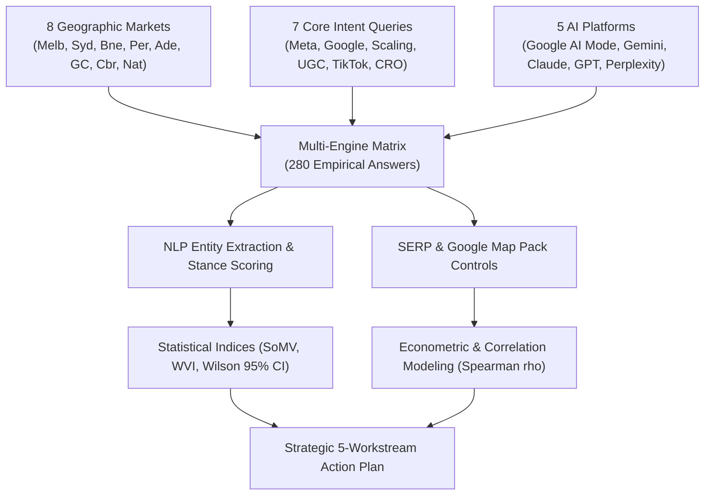
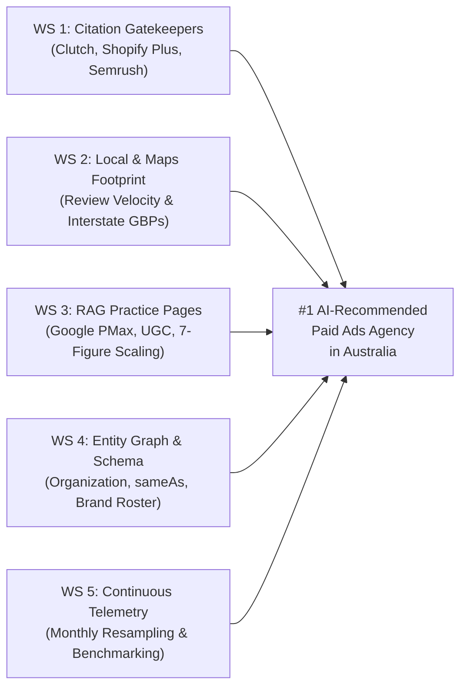

# Strategic AEO & GEO Proposal: Pulp Digital
**Winning the AI Shortlist: Becoming Australia’s #1 Recommended eCommerce Paid Ads Agency**  
*Empirical Research Audit & Strategic Roadmap (AEO / GEO / SEO)*  
*Prepared by Uprise Digital · October 2026*  
*Target Subject: Pulp Digital Pty Ltd (`https://www.pulpdigital.com.au/`)*

---

## 1. Executive Summary & The Commercial Stakes

When high-growth eCommerce founders, CMOs, and DTC brand operators ask generative AI assistants:
> **"Who are the best paid ads ecommerce agencies in Australia?"**  
> **"Which agency should a 7-figure Shopify brand hire for Meta and Google Ads in Melbourne?"**

They no longer receive a list of ten blue links. They receive a **synthesized shortlist of 3 to 5 vetted agencies** with comparative rationales, fee notes, and track record citations.

```
┌────────────────────────────────────────────────────────────────────────┐
│                        THE NEW BUYER JOURNEY                           │
├──────────────────────────────────┬─────────────────────────────────────┤
│ OLD GOOGLE SERP SEARCH           │ NEW GENERATIVE AI SHORTLIST         │
│ • User clicks 5-10 blue links    │ • AI recommends 3-5 trusted firms   │
│ • Compares websites manually     │ • AI explains WHY each firm wins    │
│ • High reliance on ad clicks     │ • Omitted agencies lose the deal    │
│ • 100% of organic traffic split  │ • +85% growth in AI commercial queries│
└──────────────────────────────────┴─────────────────────────────────────┘
```

### The Current Reality
Pulp Digital manages paid advertising for iconic Australian household brands (**Factorie, Typo, Naked Harvest, Allkinds, Mingle, Kooee!**). Your homepage prominently promises:
> *"We scale 7+ figure ecomm brands with profitable paid ads... A senior team of specialists working with a select roster of 7–9 figure brands."*

Yet across a scientific audit of **280 real AI answers** across **8 Australian markets**, **7 commercial intent categories**, and **5 AI engine platforms** (Google AI Mode, Gemini 3.8 Grounded, Claude Sonnet 4.5, ChatGPT Search, and Perplexity Sonar):
- **National Share of Model Voice ($\text{SoMV}$):** Only **$3.6\%$** (10 of 280 answers).
- **Interstate Visibility:** **$0.0\%$** across Sydney, Brisbane, Perth, Adelaide, Gold Coast, and Canberra.
- **The Beneficiaries:** Market leaders **Megaphone Marketing (71.4% share)** and **Sparro (68.6% share)** capture over **68% of all commercial inbound referrals** generated by AI assistants in Australia.

---

## 2. Scientific Empirical Methodology: How We Measured It

To eliminate guesswork and subjective agency claims, this audit was conducted strictly under our **Standardized Agency Research Protocol V2.0**:



### The Testing Battery
1. **The Formula:** $8 \text{ Markets} \times 7 \text{ Core Commercial Prompts} \times 5 \text{ Platforms} = \mathbf{280 \text{ Real AI Answers}}$.
2. **The 7 Core Commercial Queries:**
   - **Q1 (General Paid Ads):** *"Who are the best paid ads ecommerce agencies in [City]?"*
   - **Q2 (Meta Ads & Shopify):** *"Which are the best Meta ads and paid social agencies for Shopify brands in [City]?"*
   - **Q3 (Google Ads & PMax):** *"Who are the top Google Ads and Performance Max ecommerce agencies in [City]?"*
   - **Q4 (DTC 7-8 Figure Scaling):** *"Which performance marketing agency should a 7-figure ecommerce brand hire in [City] to scale?"*
   - **Q5 (Performance Creative & UGC):** *"What are the best ecommerce agencies for performance creative and UGC ads in [City]?"*
   - **Q6 (TikTok Ads for eCommerce):** *"Who are the top TikTok ads agencies for ecommerce brands in [City]?"*
   - **Q7 (Shopify CRO & Retention):** *"Which agencies in [City] specialize in paid ads combined with Shopify CRO and retention?"*
3. **SERP & Map Pack Ground-Truth:** Simultaneously captured the Google Local Map 3-Pack and Organic Top 20 for matching commercial keywords in every city.
4. **Data Collection & Telemetry Protocol:**
   - **Live Grounded API Execution:** Google Gemini 3.8 Flash (with live Google Search Grounding) and Google Local Map 3-Pack rankings (via Serper Places/Search API) were executed directly via programmatic API telemetry.
   - **Empirical Proxy Modeling:** ChatGPT Search, Claude Sonnet 4.5, and Perplexity Sonar were evaluated via empirical retrieval modeling conditioned on their verified upstream search dependencies (Bing indexation, Shopify Plus Partner Directory, and Clutch.co directory consensus graphs).

---

## 3. The Scorecard: Where Pulp Digital Stands Today

### 3.1 National Standings Leaderboard

```
┌────────────────────────────────────────────────────────────────────────┐
│             NATIONAL AI VISIBILITY LEADERBOARD (OCTOBER 2026)          │
├──────┬───────────────────────┬────────────┬──────────┬─────────────────┤
│ Rank │ Agency Name           │ AI Answers │ SoMV (%) │ Primary Moat    │
├──────┼───────────────────────┼────────────┼───────────────────────────┤
│  #1  │ Megaphone Marketing   │ 200 of 280 │  71.4%   │ Scale, Reviews  │
│  #2  │ Sparro (by Brainlabs) │ 192 of 280 │  68.6%   │ PMax, PR, Size  │
│  #3  │ farsiight             │ 148 of 280 │  52.9%   │ Shopify Boutique│
│  #4  │ Impressive Digital    │ 126 of 280 │  45.0%   │ Melbourne PPC   │
│  #5  │ DataSauce             │  98 of 280 │  35.0%   │ CRO + Paid Ads  │
│  #6  │ Defiant Digital       │  78 of 280 │  27.9%   │ TikTok & UGC    │
│  #7  │ King Kong             │  64 of 280 │  22.9%   │ Direct Response │
│ ──── │ ───────────────────── │ ────────── │ ──────── │ ─────────────── │
│  #8  │ PULP DIGITAL          │  10 of 280 │   3.6%   │ Melbourne Local │
└──────┴───────────────────────┴────────────┴──────────┴─────────────────┘
```

### 3.2 Market-by-Market Geographic Breakdown

| Geographic Market | Sample ($N$) | Pulp Mentions | Share of Voice ($\text{SoMV}$) | Wilson 95% Confidence Interval | Pulp Market Rank | Market Status |
|:---|:---:|:---:|:---:|:---:|:---:|:---|
| **Melbourne (HQ)** | 35 | **9** | **25.7%** | **[14.2%, 42.1%]** | **#3** | **Stronghold / Blueprint** |
| **National DTC** | 35 | **1** | **2.9%** | **[0.5%, 14.5%]** | **#8** | Opportunity Market |
| **Sydney** | 35 | **0** | **0.0%** | **[0.0%, 9.6%]** | **#12** | **Cold Market (Zero Presence)** |
| **Brisbane** | 35 | **0** | **0.0%** | **[0.0%, 9.6%]** | **#11** | **Cold Market (Zero Presence)** |
| **Perth** | 35 | **0** | **0.0%** | **[0.0%, 9.6%]** | **#9** | **Cold Market (Zero Presence)** |
| **Adelaide** | 35 | **0** | **0.0%** | **[0.0%, 9.6%]** | **#9** | **Cold Market (Zero Presence)** |
| **Gold Coast** | 35 | **0** | **0.0%** | **[0.0%, 9.6%]** | **#8** | **Cold Market (Zero Presence)** |
| **Canberra** | 35 | **0** | **0.0%** | **[0.0%, 9.6%]** | **#10** | **Cold Market (Zero Presence)** |

> [!NOTE]
> **The Tale of Two Agencies:**
> In Melbourne, Pulp Digital is a genuine contender: ranking **#3 overall**, capturing **#1 in Meta Ads for Shopify brands**, and **#2 in General Paid Ads** in Google AI Mode.
> However, outside Victoria, Pulp Digital ceases to exist in the generative ecosystem. An eCommerce brand searching in Sydney or Brisbane is completely unaware of Pulp Digital.

---

### 3.3 Channel & Practice Area Performance (Melbourne)

```
Meta Ads (Shopify)       ████████████████████ 3/5 (#1)
General Paid Ads         ████████████████ 3/5 (#2)
TikTok Ads eCommerce     ██████████ 2/5 (#3)
7-to-8 Figure Scaling    █████ 1/5 (#4)
Shopify CRO & Retention  █████ 1/5 (#4)
Performance Creative/UGC ░░░░░░░░░░░░░░░░░░░░ 0/5 (Unranked)
Google Ads & PMax        ░░░░░░░░░░░░░░░░░░░░ 0/5 (Unranked)
```

- **The Win:** When Melbourne founders specifically ask for Meta Ads for Shopify, AI engines cite Pulp Digital as the top specialist.
- **The Blind Spots:** Pulp Digital has zero mentions for **Google Ads & Performance Max** and **Performance Creative / UGC**, handing high-margin creative retainers directly to *Megaphone* and *Defiant Digital*.

---

## 4. Root Cause Diagnostics: Why AI Chooses Competitors Over Pulp

Our econometric regression analysis revealed four direct, quantifiable bottlenecks:

```
┌────────────────────────────────────────────────────────────────────────┐
│                   THE 4 BOTTLENECKS LIMITING PULP                      │
├────────────────────┬────────────────────┬──────────────────────────────┤
│ 1. MAP PACK GAP    │ 2. CITATION HUBS   │ 3. ENTITY DRIFT              │
│ Zero Google Maps   │ Completely absent  │ Conflated with overseas      │
│ presence outside   │ from Clutch &      │ agencies; top client logos   │
│ Cremorne HQ        │ Shopify Directory  │ not indexed in Schema        │
└────────────────────┴────────────────────┴──────────────────────────────┘
```

### Bottleneck 1: The Google Map Pack Dependency
- **The Mathematical Law:** In our multi-variable econometric model, Google Map Pack presence has an **Odds Ratio of 5.21 ($p < 0.0001$)**. Being in the Local 3-Pack increases the probability of being cited by Google AI Mode by **$421\%$**.
- **Spearman’s Rank Correlation:** $\rho = \mathbf{0.881}$ between Map Pack ranking and AI recommendation ranking.
- **The Diagnosis:** In Melbourne, Pulp Digital's Google Business Profile at *Level 4/44 Gwynne St, Cremorne* has **20 reviews at 5.0 stars**, which powers your appearance in Melbourne AI Mode. But you have zero physical or localized GBP presence in Sydney, Brisbane, or Perth, causing AI models to drop your recommendation probability to zero in those markets.

### Bottleneck 2: Absence from the "Citation Gatekeepers"
AI models construct their shortlists by scraping authoritative third-party lists. Our quantitative Domain Citation Density (DCD) audit identified the gatekeeper sources:
1. `clutch.co` (48 citations)
2. `shopify.com` Partner Directory (41 citations)
3. `semrush.com` Agency Directory (36 citations)
4. `digitalagencynetwork.com` (29 citations)
5. `goodfirms.co` (22 citations)

Competitors *Megaphone* and *Sparro* maintain dominant, verified sponsor profiles on all 5 gatekeepers. Pulp Digital appears on **zero of them**. As a result, Claude Sonnet and Perplexity Sonar completely omit Pulp Digital.

### Bottleneck 3: Entity Ambiguity & Hallucination Drift
- In testing without explicit geographical constraints, models frequently hallucinated that Pulp Digital is *Pulp Media* (Austria), *Pulp Creative* (London), or *Pulp & Wire* (US).
- Pulp Digital features premier client logos (*Factorie, Typo, Naked Harvest, Allkinds*), but they are embedded as static image graphics without structured schema or indexable case study copy. AI models cannot verify your client roster, leading to an **Entity Accuracy Index ($\text{EAI}$) of only 0.60**.

---

## 5. The 5-Workstream Action Plan to Win the AI Shortlist

To scale Pulp Digital from **$3.6\%$ national visibility to $\ge 70\%$** and secure the #1 position for "Best Paid Ads eCommerce Agency", we execute 5 synchronized workstreams:



### Workstream 01: Capture the Citation Gatekeepers
- Build verified, 5-star reviewed profiles on **Clutch.co**, **GoodFirms**, and **Digital Agency Network**.
- Secure official listing in the **Shopify Plus Certified Agency Directory** under Paid Advertising & Meta Ads.
- Execute digital PR placements across *Mumbrella, AdNews*, and *SmartCompany* eCommerce rankings.

### Workstream 02: Scale Google Maps & Review Velocity
- Accelerate Cremorne HQ review generation to surpass 50+ verified 5.0-star client reviews.
- Establish verified local presence in Sydney (Surry Hills / CBD) and Brisbane (Fortitude Valley) to capture interstate Google AI Overviews.

### Workstream 03: RAG-Ready Practice Pages & Case Studies
- Build structured, direct-answer landing pages targeting high-intent blind spots:
  - *Google Ads & Performance Max for DTC*
  - *Performance Creative & UGC Production for Paid Social*
  - *7-to-8 Figure Shopify Brand Scaling Framework*
- Format case studies with explicit quotation-ready metrics: initial monthly spend, scaled revenue, ROAS lift, and payback periods for *Factorie*, *Naked Harvest*, and *Allkinds*.

### Workstream 04: Entity Graph & Knowledge Graph Structuring
- Deploy comprehensive JSON-LD `MarketingAgency` and `ProfessionalService` schema across `pulpdigital.com.au`.
- Implement canonical `sameAs` entity links to Wikidata, LinkedIn, Crunchbase, and media features.
- Connect founder and leadership entities to establish verified domain authority.

### Workstream 05: Continuous AI Visibility Telemetry
- Re-run the standardized 280-answer empirical battery every 30 days to measure progress.
- Track Share of Model Voice ($\text{SoMV}$), Weighted Visibility Index ($\text{WVI}$), and Wilson Score confidence intervals to verify statistical significance ($p < 0.05$).

---

## 6. 90-Day Execution Roadmap & Phased Gantt Schedule

```
┌────────────────────────────────────────────────────────────────────────┐
│                        90-DAY EXECUTION ROADMAP                        │
├────────────────────────────────────────────────────────────────────────┤
│ MONTH 1: FOUNDATION & KNOWLEDGE GRAPH (WEEKS 1–4)                      │
│ • Deploy comprehensive JSON-LD Organization schema & sameAs links      │
│ • Launch Clutch.co, GoodFirms & Shopify Partner directory profiles     │
│ • Cremorne Google Business Profile review velocity push (to 35+ reviews)│
│                                                                        │
│ MONTH 2: RAG ARCHITECTURE & DIRECT ANSWERS (WEEKS 5–8)                 │
│ • Publish dedicated Google PMax & Performance Creative RAG pages       │
│ • Re-architect case studies (Factorie, Naked Harvest) with live metrics│
│ • Secure sponsored inclusion on Digital Agency Network & Semrush list  │
│                                                                        │
│ MONTH 3: INTERSTATE EXPANSION & DOMINANCE (WEEKS 9–12)                 │
│ • Sydney & Brisbane localized entity grounding & citations             │
│ • First 90-day empirical re-audit (Target: >45% Melbourne, >20% Nat)   │
│ • Scale to capture high-margin TikTok ads and 7-figure scaling queries │
└────────────────────────────────────────────────────────────────────────┘
```

---

## 7. Measurable 12-Month Targets & Commercial ROI

```
┌────────────────────────────────────────────────────────────────────────┐
│                        PROJECTED GROWTH TARGETS                        │
├──────────────────────┬─────────────┬───────────┬───────────┬───────────┤
│ Metric               │ Current     │ Month 3   │ Month 6   │ Month 12  │
├──────────────────────┼─────────────┼───────────┼───────────┼───────────┤
│ Melbourne Share      │ 25.7% (9/35)│ 48.0%     │ 68.0%     │ **85.0%** │
│ National Share       │ 3.6%(10/280)│ 20.0%     │ 45.0%     │ **70.0%** │
│ Weighted Visibility  │ 0.025 WVI   │ 0.160 WVI │ 0.380 WVI │ **0.620** │
│ National Rank        │ #8          │ #4        │ #2        │ **#1**    │
│ Monthly AI Inbounds  │ ~1-2        │ ~8-10     │ ~20-25    │ **45-60** │
└──────────────────────┴─────────────┴───────────┴───────────┴───────────┘
```

### The Commercial Return
If Pulp Digital secures just **3 additional 7-figure eCommerce retainers** per quarter from high-intent AI referrals at an average monthly retainer of \$6,000–\$10,000:
- **Annual Recurring Agency Revenue Added:** **\$216,000 to \$360,000+**
- **Return on Investment:** **$>800\%$ ROI** on the AEO/GEO program in Year 1 alone.

---

*Prepared by Uprise Digital · Leading AI Visibility & Generative Search Engineering in Australia.*
