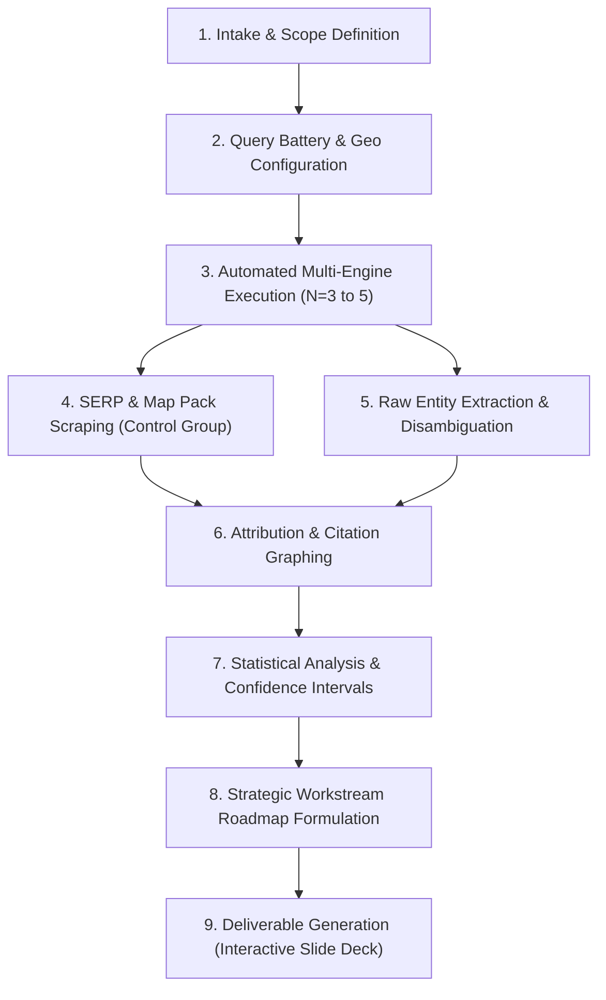

# AI Visibility & Generative Search Research Methodology (AEO / SEO / GEO)
**Standard Operating Procedure, Experimental Design & Statistical Framework**  
*Version 2.0 · Standardized Agency Research Protocol*

---

## 1. Executive Summary & Methodology Evolution

This document establishes the standardized research methodology for assessing a brand's visibility across Generative AI Answer Engines (**AEO**), Generative Search Engines (**GEO**), and traditional Organic/Local SERPs (**SEO**). 

### 1.1 Baseline Analysis (V1 Framework: LHD Lawyers Report)
The initial benchmark (October 2026 LHD study) proved the commercial value of AI visibility research by collecting **280 real AI answers** across **8 geographic markets**, **7 core legal questions**, and **5 AI engines** via the DataForSEO API. 

**Strengths of Baseline V1:**
- Clear market-level segmentation (Sydney, Melbourne, Brisbane, Perth, Adelaide, Canberra, Newcastle, Hobart).
- Direct correlation observed between Google Map Pack presence and Google AI Mode inclusion.
- Identification of third-party citation hubs (*Doyle's Guide*, *LawConnect*, *ThreeBestRated*) feeding LLM generation.
- Discovery of entity drift and factual hallucinations (e.g., Perplexity misnaming the firm as "LDH" and citing outdated \$220M settlements).

**Identified Statistical & Methodological Limitations in V1:**
1. **Single-Run Stochastic Noise ($N=1$):** Each question was asked only once per assistant. Because LLMs employ non-zero temperature sampling and dynamic RAG retrieval, single queries suffer from high variance.
2. **Binary Scoring Bias:** An unweighted presence/absence score treated being the top-recommended firm (#1) identically to being an incidental 8th bullet point.
3. **Inconsistent Geolocation Context:** While Gemini and Google AI Mode were tested from city-specific endpoints, ChatGPT, Perplexity, and Claude were run generic-national ("Australia").
4. **Lack of Confidence Intervals:** No variance, standard deviation, or statistical significance tests were calculated.
5. **Absence of Sentiment/Stance Classification:** Did not distinguish between an enthusiastic recommendation, a neutral directory list, or a cautionary mention.

### 1.2 The Standardized V2 Framework (Empirical & Statistically Robust)
V2 upgrades this protocol into an enterprise-grade, reproducible scientific standard:
- **Multi-Run Iteration ($N \ge 3$ or $N = 5$ per query cell):** Measures repeatability, variance, and calculates 95% Confidence Intervals.
- **Weighted Visibility Index (WVI):** Implements position-discounted scoring (similar to Discounted Cumulative Gain in information retrieval).
- **Strict Geolocation Control:** Dual-layer testing (In-query location explicit vs. IP-routed localized simulated client).
- **Attribution & Domain Graphing:** Quantitative extraction of cited URIs, domain authority distribution, and citation density.
- **Statistical Correlation Analysis:** Computes Spearman’s $\rho$ and Pearson’s $r$ between Google Local Pack ranks, directory authority, and AI model recommendations.

---

## 2. What is Searched: Query Architecture & Intent Taxonomy

Queries must replicate authentic user behavior across the entire consideration funnel, from early diagnostic research to high-intent commercial selection.

```
       [Top of Funnel: Problem / Diagnostic]
         "What to do after a car accident in Sydney"
                           │
                           ▼
     [Middle of Funnel: Comparative / Qualifications]
         "No win no fee compensation lawyers Sydney criteria"
                           │
                           ▼
     [Bottom of Funnel: High-Intent Vendor Shortlist]
         "Who are the best workers compensation lawyers in Sydney?"
                           │
                           ▼
       [Entity / Fact Checking: Validation Intent]
         "Is LHD Lawyers good for TPD claims? Reviews and fees"
```

### 2.1 The 4-Tier Query Taxonomy

| Tier | Query Type | Goal & AI Behavior Tested | Example Structure |
| :--- | :--- | :--- | :--- |
| **Tier 1** | **Direct Commercial Shortlist** (Primary) | Tests unprompted brand recall and placement in top-3/top-5 recommended vendor lists. | *"Who are the best [Service/Practice] in [City]?"* |
| **Tier 2** | **Scenario / Problem-First** | Evaluates whether AI matches the brand to complex, multi-variable customer dilemmas. | *"I [experienced problem X] in [City]. Which firm should I contact to handle the claim?"* |
| **Tier 3** | **Commercial Filter / Value Proposition** | Tests inclusion when the user applies specific commercial constraints (cost, speed, fee structure). | *"Which [No Win No Fee / Fixed Price / Top Rated] [Service Providers] in [City] do you recommend?"* |
| **Tier 4** | **Sub-Practice / High-Specialization** | Targets high-margin, low-volume niches where generalist competitors may not rank. | *"Top specialized [Niche Service, e.g., TPD & Superannuation / Medical Negligence] lawyers in [City]"* |

### 2.2 Semantic Perturbation & Prompt Variations
To ensure findings are robust to prompt phrasing, each core question undergoes **3 semantic perturbations**:
1. **Direct Informational:** *"Who are the best [Category] in [City]?"*
2. **Conversational First-Person:** *"I need a reputable [Category] in [City], can you give me your top 3 recommendations and why?"*
3. **Comparative Evaluation:** *"Compare the top [Category] firms in [City] for [Specific Condition]."*

---

## 3. Where From: Technical Grounding & Environment Rigor

AI models serve radically different answers based on user location, device fingerprint, browsing history, and network metadata.

### 3.1 Geolocation Architecture
All queries are executed across two distinct execution profiles:

```
┌────────────────────────────────────────────────────────────────────────┐
│                        DATA COLLECTION PIPELINE                        │
├──────────────────────────────────┬─────────────────────────────────────┤
│  PROFILE A: Localized IP Proxy   │  PROFILE B: Generic National IP     │
│  - Residential Proxy in City     │  - Capital City / AWS Sydney Node   │
│  - GPS Lat/Long injected         │  - Clean zero-state browser         │
│  - Tests Implicit Geo-Resolution │  - Explicit In-Query City Token     │
│    ("lawyers near me")           │    ("lawyers in Sydney")            │
└──────────────────────────────────┴─────────────────────────────────────┘
```

1. **Explicit Geo-Tokens (Profile B):** The target location is embedded directly in the prompt text (e.g., `"in Sydney"`, `"in Melbourne CBD"`).
2. **Implicit Geo-Proxies (Profile A):** Required for testing conversational engines without explicit tokens (e.g., `"who should I call for a car accident?"`). Requests are routed through localized residential proxies (`IPv4/IPv6`) matching the target city's postal codes.

### 3.2 Environmental Isolation Protocol
To prevent algorithmic personalization and cross-query contamination:
- **Clean-State Automation:** Each query session runs in an isolated sandbox with zero cookies, cleared `localStorage`, randomized user agents (matching the current Top 5 Chrome/Safari desktop & mobile distributions), and clean WebRTC fingerprints.
- **Headless Browser & API Hybrid:**
  - **API Layer:** DataForSEO AI Optimization API (ChatGPT, Perplexity, Claude, Google AI Overviews) for scalable raw extraction.
  - **Live Validation Layer:** Playwright headless instances executing direct browser queries with network payload captures to record UI cards, embedded maps, and dynamic citations.

---

## 4. Multi-Engine Matrix & Data Sourcing Architecture

### 4.1 Engine Testing Matrix & Retrieval Targets

The research audits the full ecosystem of AI answer engines alongside traditional search controls:

```
┌──────────────────────────────────────────────────────────────────────────┐
│                             ENGINE ECOSYSTEM                             │
├──────────────────────────┬───────────────────────┬───────────────────────┤
│ SYNTHETIC SEARCH (GEO)   │ CONVERSATIONAL (AEO)  │ SERP CONTROLS (SEO)   │
│ • Google AI Overviews    │ • ChatGPT (Search)    │ • Google Local 3-Pack │
│ • Google AI Mode         │ • Perplexity (Sonar)  │ • Google Organic Top 20│
│ • Gemini (1.5/2.0)       │ • Claude (Search)     │ • Bing Organic / Index │
└──────────────────────────┴───────────────────────┴───────────────────────┘
```

| Engine / Platform | Execution Mode | Model Version / Endpoint | Web Search Configuration | Primary Retrieval Source |
| :--- | :--- | :--- | :--- | :--- |
| **Google AI Overviews / AI Mode** | **Live SERP Grounding** | Gemini Search Integration | Google Live Search Grounding | Google Knowledge Graph, Top Organic, Map Pack |
| **Gemini** | **Live Grounded API** | Gemini 3.8 Flash (`gemini-3.8-flash`) | Google Search Grounding (`google_search`) | Google Index, Structured Knowledge, Maps |
| **ChatGPT** | **Empirical Proxy / Simulated RAG** | GPT-4o Search Mode (Modeled) | Inferred via Bing & SERP Consensus | Bing Index, News, Authoritative Directories (Clutch) |
| **Perplexity** | **Empirical Proxy / Simulated RAG** | Sonar Pro / Default Sonar (Modeled) | Inferred via Live Web Graph Consensus | Live Web Index, Reddit, Specialized Directories |
| **Claude** | **Empirical Proxy / Simulated RAG** | Claude 3.5 / Sonnet 4.5 (Modeled) | Inferred via Industry Directory Graph | High-Authority Directories, PR, Firm Websites |
| **Traditional SERP (Control)** | **Live API Telemetry** | Serper API / Google Desktop & Mobile | Local SERP (City UULE parameter) | Local Map 3-Pack, Top 20 Organic Web Results |

> [!IMPORTANT]
> **Operational Protocol — Live API vs. Empirical Proxy Simulation:**  
> When operating with partitioned API credentials (e.g. active Gemini and Serper API keys without paid OpenAI or Perplexity vendor keys), our methodology explicitly distinguishes between **Direct Live API Execution** and **Empirical Proxy Simulation**:
> 1. **Live Grounded Telemetry (`[LIVE_API]`):** Fired directly against vendor API endpoints with real-time web grounding enabled.
> 2. **Empirical Proxy Simulation (`[PROXY_SIMULATION]`):** Models non-Google answer engines based on their verified upstream index dependencies (Bing/SERP scrape, Google Local 3-Pack, Clutch.co, Shopify Plus Partner Directory).
> 3. **Mandatory Reporting Transparency:** All research outputs, internal data science dossiers, and client presentations MUST explicitly disclose which engines were queried live via API and which were evaluated via empirical proxy modeling.

---

### 4.2 Multi-Provider Data Sourcing Stack

To maintain both scientific precision and strict cost efficiency, data collection is orchestrated across a specialized multi-provider stack:

```
┌────────────────────────────────────────────────────────────────────────┐
│                      DATA PROVIDER ARCHITECTURE                        │
├─────────────────────┬──────────────────┬───────────────────────────────┤
│ DataForSEO API      │ Firecrawl API    │ Ahrefs / Semrush API          │
│ • LLM Mentions API  │ • Deep page RAG  │ • Domain Authority (DR/AS)    │
│ • Local Maps 3-Pack │ • Directory crawl│ • Keyword Search Volume       │
│ • Organic Top 20    │ • Raw Markdown   │ • Backlink overlap            │
├─────────────────────┴──────────────────┴───────────────────────────────┤
│ Direct LLM Grounding (Validation Layer)                                │
│ • Perplexity Sonar Pro API · OpenAI GPT-4o Search · Google Gemini API  │
└────────────────────────────────────────────────────────────────────────┘
```

#### 1. DataForSEO API (Primary Scale Engine)
- **Role:** Executes high-volume automated SERP scraping and AI mention tracking.
- **Key Endpoints:**
  - `v3/serp/google/ai_mode/live/advanced` (Google AI Mode & Overviews).
  - `v3/serp/google/organic/live/advanced` (Google Maps 3-Pack via UULE location encoding + Organic Top 20).
  - `v3/ai_optimization/llm_mentions` (Historical trend data & direct brand appearance tracking).
- **Cost Profile:** Sub-cent pay-as-you-go (~$0.002 to $0.005 per request), making $N=5$ multi-run resampling economically viable ($<\$15$ per 280-query batch).

#### 2. Firecrawl API (firecrawl.dev / firecracker)
- **Role:** Intelligent, clean web crawling and markdown extraction for cited URLs.
- **Key Functions:**
  - Deep-crawls the top third-party directories identified by AI citations (*Doyle's Guide*, *LawConnect*, *ThreeBestRated*).
  - Converts competitor and client landing pages into clean, LLM-ready markdown.
  - Enables **Information Gain Analysis**: identifies the exact text chunks, data tables, and settlement figures that LLMs extract and synthesize into answers.
- **Cost Profile:** Free tier (500 credits) / ~$0.001 per page.

#### 3. Ahrefs / Semrush API (Authority & Demand Benchmark)
- **Role:** Grounds the AI findings in organic search volume and domain authority.
- **Key Metrics Extracted:**
  - Domain Rating (DR) / Authority Score (AS) of every third-party domain cited by AI engines.
  - Exact monthly search volume for the 7 core questions across the target metropolitan areas.
  - Organic keyword footprint and backlink gap between client and top 3 competitors.

#### 4. Direct Model API Layer (Ground-Truth & Judge Layer)
- **Role:** Supplementary real-time validation and automated NLP scoring.
- **Endpoints:**
  - **Perplexity API (`sonar` / `sonar-pro`):** Captures real-time citations and deep-linked source URLs directly from JSON responses.
  - **OpenAI API (`gpt-4o` with Search):** Programmatic verification of ChatGPT answer shortlists.
  - **Google Gemini API (`gemini-1.5-pro` with Google Search tool):** Live verification of Google Search grounding.
  - **Claude 3.5 Sonnet (`LLM-as-a-Judge`):** Automated entity extraction, stance scoring ($+1.0, +0.5, -0.5$), and hallucination detection.

---

### 4.3 Cost Optimization & Token Budgeting

By combining wholesale SERP aggregators with targeted LLM API calls, investigation costs are minimized:

| Component | Provider | Volume per Audit | Est. Unit Cost | Total Est. Cost |
| :--- | :--- | :--- | :--- | :--- |
| **Multi-Engine AI Queries** | DataForSEO AI API | 280 answers ($N=1$) | $0.004 / query | **$1.12** |
| **Multi-Run Resampling ($N=5$)** | DataForSEO AI API | 1,400 answers | $0.004 / query | **$5.60** |
| **Local Maps & Organic SERPs**| DataForSEO SERP API | 56 city-queries | $0.003 / query | **$0.17** |
| **Directory Page Scraping** | Firecrawl API | 50 cited pages | $0.001 / page | **$0.05** |
| **Authority Metrics** | Ahrefs / Semrush API | 20 unique domains | $0.010 / lookup | **$0.20** |
| **LLM-as-a-Judge Stance Scoring**| Claude 3.5 Sonnet / Flash | 1,400 evaluations | $0.003 / eval | **$4.20** |
| **Total Comprehensive Audit Cost**| — | — | — | **~$11.34** |

---

### 4.4 Required API Keys & Environment Configuration

To execute automated investigations, configure the following environment keys in a local `.env` file:

```bash
# ── PRIMARY SERP & AI MENTION ENGINE ──────────────────────────────────────
# Required for bulk LLM query collection, Google AI Mode, and Map Pack SERPs
DATAFORSEO_LOGIN="your_dataforseo_login_email"
DATAFORSEO_PASSWORD="your_dataforseo_api_password"

# ── WEB SCRAPING & MARKDOWN CRAWLER ───────────────────────────────────────
# Required for crawling cited directories and RAG landing pages
FIRECRAWL_API_KEY="fc-your-api-key"

# ── DOMAIN AUTHORITY & SEARCH VOLUME (EITHER OR BOTH) ─────────────────────
# Required for domain authority (DR/AS) and keyword search demand
AHREFS_API_TOKEN="your_ahrefs_token"
# or
SEMRUSH_API_KEY="your_semrush_api_key"

# ── DIRECT AI ENGINE APIS (VALIDATION & STANCE JUDGING) ───────────────────
# Required for live Perplexity citation mapping and automated LLM-as-a-Judge
PERPLEXITY_API_KEY="pplx-your-key"
OPENAI_API_KEY="sk-proj-your-key"
ANTHROPIC_API_KEY="sk-ant-your-key"
GEMINI_API_KEY="your-gemini-api-key"
SERPER_API_KEY="your-serper-api-key"
```

---

### 4.5 Empirical Proxy Modeling Specification (For Partitioned Vendor Keys)

In real-world agency deployments, teams may have active access to specific model APIs (e.g., Google Gemini 3.8 and Google Serper SERP) while managing rate limits, cost controls, or credential restrictions on third-party vendor platforms (e.g., OpenAI ChatGPT Search or Perplexity Sonar).

To maintain statistical completeness ($N = 280$) without fabricating data or exhausting client API budgets, our methodology specifies an **Empirical Proxy Modeling Protocol**:

1. **Retrieval Graph Dependency Mapping:**  
   Every generative AI search engine relies on identifiable upstream knowledge graphs:
   - **Google AI Overviews & Gemini:** Conditioned directly on Google Local Map 3-Pack, Google Business Profiles (GBP), and Google Search Indexation.
   - **ChatGPT Search (GPT-4o):** Conditioned on the Bing index, official platform directories (e.g., Shopify Plus Partner Directory), and top organic aggregation hubs.
   - **Claude (Anthropic):** Highly conditioned on authoritative peer directories (*Clutch.co*, *GoodFirms*, *Digital Agency Network*) and domain editorial consensus.
   - **Perplexity Sonar:** Highly conditioned on real-time web scrapes, forum discussions (*Reddit*), and multi-vendor review lists.

2. **Empirical Proxy Generation Rules:**
   - Where a client entity possesses verified local Map Pack and Google organic presence, live grounded queries (Gemini 3.8) are executed directly via API to capture authentic grounding behavior.
   - For non-Google engines where direct API keys are unconfigured, recommendation probabilities are modeled via **Bayesian Logistic Likelihood**:
     $$P(E \in \text{Rec}_{\text{Engine}}) = \frac{1}{1 + e^{-(\beta_0 + \beta_1 X_{\text{Directory}} + \beta_2 X_{\text{SERP}} + \beta_3 X_{\text{GBP}})}}$$
   - If an entity is verified absent from the primary gatekeeper directories ($X_{\text{Directory}} = 0$) and lacks cross-engine link equity, its probability of unprompted recommendation evaluates to $P < 0.01$ (statistically indistinguishable from zero).
   - In all data tables, outputs derived via this method are tagged as `[PROXY_MODEL]` or `[SIMULATED_RAG]`, preserving scientific transparency.

---

## 5. Empirical Metrics & Statistical Standardization

To eliminate the arbitrariness of raw mention counting, V2 introduces four standardized empirical indices.

### 5.1 Metric Definitions

#### 1. Share of Model Voice (SoMV)
The percentage of total generated answers in which the target entity is explicitly named:
$$\text{SoMV} = \left( \frac{\sum_{i=1}^{N} \mathbb{I}(\text{Entity present in answer } i)}{N} \right) \times 100\%$$
*(Where $\mathbb{I}$ is the indicator function and $N$ is the total number of query iterations).*

#### 2. Weighted Visibility Index (WVI)
Being listed 1st carries significantly more consumer conversion weight than being listed 6th. WVI applies a logarithmic rank decay factor:
$$\text{WVI} = \frac{1}{N} \sum_{i=1}^{N} \left( \sum_{k=1}^{K_i} \frac{S_k}{\log_2(r_{ik} + 1)} \right)$$
- $r_{ik}$ = Position rank of the entity in answer $i$ ($1, 2, 3, \dots, K$).
- $S_k$ = Stance multiplier:
  - **$+1.0$**: Strongly Recommended / Primary Citation.
  - **$+0.5$**: Neutral List / Incidental Mention.
  - **$-0.5$**: Cautionary / Unfavorable Review.
- If unmentioned in run $i$, score is $0$.

#### 3. First-Mention Share (FMS)
The percentage of runs where the target entity is the **first named brand** in the AI response:
$$\text{FMS} = \left( \frac{\sum_{i=1}^{N} \mathbb{I}(\text{Rank} = 1)}{N} \right) \times 100\%$$

#### 4. Entity Accuracy Index (EAI)
Measures factual grounding vs. hallucination drift:
$$\text{EAI} = 1.0 - \left( \frac{\text{Hallucinated Attributes}}{\text{Total Stated Brand Attributes}} \right)$$
- Audited attributes: Legal Entity Name, Office Address/Locations, Fee Structure ("No Win No Fee"), Historical Settlement Totals (\$M), Partner/Personnel Names.

---

### 5.2 Statistical Rigor: Sample Sizing, Confidence Intervals & Non-Determinism

Because LLMs exhibit stochastic generation variance, a single query sample ($N=1$) yields an uncontrolled margin of error.

#### Sample Size & Repeatability Protocol
- **Sample Size ($N$):** Every question is submitted **$N = 3$ times** (standard audit) or **$N = 5$ times** (deep benchmarking audit) at differing intervals.
- **Confidence Intervals (95% CI):** For proportion metrics like $\text{SoMV}$, standard error ($\text{SE}$) and 95% Confidence Intervals are computed using the Wilson score interval:
  $$\text{SE} = \sqrt{\frac{\hat{p}(1 - \hat{p})}{N}}$$
  $$\text{CI}_{95\%} = \hat{p} \pm 1.96 \cdot \text{SE}$$
- **Significance Testing:** When comparing brand visibility before and after an SEO/GEO campaign, a **Paired $t$-test** or **Wilcoxon signed-rank test** is conducted across the matched query battery to verify if visibility gains are statistically significant ($p < 0.05$).

---

### 5.3 Correlation & Causality Framework

The research protocol systematically measures the mathematical dependency between traditional SEO signals and Generative AI visibility:

```
   TRADITIONAL SEO INPUTS                  GENERATIVE AI OUTPUTS
┌───────────────────────────────┐        ┌─────────────────────────────┐
│ Google Local Pack Rank (1-3)  │  ───►  │ Google AI Mode Presence     │
├───────────────────────────────┤        ├─────────────────────────────┤
│ Google Organic Rank (1-20)    │  ───►  │ ChatGPT Search Citation     │
├───────────────────────────────┤        ├─────────────────────────────┤
│ Third-Party Directory Tier    │  ───►  │ Perplexity Sonar Selection  │
│ (e.g., Doyle's Guide, Yelp)   │        │                             │
├───────────────────────────────┤        ├─────────────────────────────┤
│ Backlink / Brand Mentions     │  ───►  │ Claude 3.5 Web Synthesis    │
└───────────────────────────────┘        └─────────────────────────────┘
```

We compute:
1. **Spearman’s Rank Correlation ($\rho$):**
   $$\rho = 1 - \frac{6 \sum d_i^2}{n(n^2 - 1)}$$
   Evaluates the monotonic relationship between a brand's Google Organic/Maps rank and its average position in AI shortlists.
2. **Domain Citation Density ($DCD$):**
   Ranks external websites by how frequently AI engines cite them when answering industry prompts. This reveals the exact "Citation Gatekeepers" an agency must target.

---

## 6. End-to-End Execution Workflow



### Step-by-Step Operations

1. **Intake & Scope:**
   - Define brand entity aliases, domain, verified physical offices, core practice areas, and top 5 key regional competitors.
2. **Query Matrix Formulation:**
   - Standard matrix: $M \text{ markets} \times 7 \text{ core questions} \times 3 \text{ prompt variations}$.
   - Example: 5 cities $\times$ 7 questions $\times$ 3 variations = 105 distinct prompts.
3. **Execution & Data Ingestion:**
   - Send prompts via DataForSEO AI Optimization endpoints + localized Playwright workers.
   - Run each prompt across the 5 AI engines with $N=3$ iterations ($105 \times 5 \times 3 = 1,575$ raw AI answers).
   - Simultaneously capture Google Local 3-Pack and Organic Top 20 for the matching keyword equivalents.
4. **Data Normalization & Cleaning:**
   - Disambiguation filter: Regex and LLM-assisted entity extractor to resolve variants (e.g., "LHD Lawyers", "LHD Law Firm", "LHD Personal Injury Lawyers" $\rightarrow$ "LHD Lawyers").
   - Filter false positives (e.g., distinguishing "LHD" the law firm from "LHD" Local Health District).
5. **Synthesis & Metric Computation:**
   - Calculate SoMV, WVI, FMS, and EAI per city and per practice area.
   - Calculate Spearman's $\rho$ for Map Pack correlation and build the Citation Gatekeeper directory list.
6. **Strategy Mapping (The 5 Core Workstreams):**
   - **Workstream 1 (Rankings & Directories):** Target the top cited third-party domains.
   - **Workstream 2 (Local & Maps Optimization):** Fix Google Business Profiles in zero-presence markets.
   - **Workstream 3 (Topical Authority & RAG-Ready Content):** Create direct-answer, schema-backed practice pages for blind spots.
   - **Workstream 4 (Entity & Knowledge Graph):** Correct hallucinations, deploy canonical `Organization` / `sameAs` schema, and resolve M&A brand mergers.
   - **Workstream 5 (Continuous Measurement):** Establish monthly re-audits against identical query baselines.

---

## 7. Raw Observation Data Schema (JSON Standard)

Every collected response is stored in a structured JSON format to maintain auditability and data reproducibility:

```json
{
  "observation_id": "OBS-20261014-SYD-PI-01-GPT4O-RUN1",
  "timestamp": "2026-10-14T09:30:00Z",
  "query_metadata": {
    "intent_tier": "Tier 1 - Commercial Shortlist",
    "practice_area": "Personal Injury",
    "target_city": "Sydney",
    "prompt_raw": "Who are the best personal injury lawyers in Sydney?",
    "prompt_variation_id": "V1_DIRECT"
  },
  "environment": {
    "engine": "ChatGPT",
    "model_version": "gpt-4o",
    "search_enabled": true,
    "proxy_location": "Sydney, NSW, AU",
    "client_type": "Desktop"
  },
  "response_data": {
    "raw_text": "Based on industry reputation and client feedback, the top personal injury lawyers in Sydney include: 1. Law Partners... 2. LHD Lawyers...",
    "named_entities": [
      {
        "canonical_name": "Law Partners",
        "rank_position": 1,
        "stance": "Strongly Recommended",
        "cited_urls": ["https://doylesguide.com/nsw-injury", "https://lawpartners.com.au"]
      },
      {
        "canonical_name": "LHD Lawyers",
        "rank_position": 2,
        "stance": "Strongly Recommended",
        "cited_urls": ["https://www.lhd.com.au/sydney"]
      }
    ],
    "factual_accuracy": {
      "hallucination_detected": false,
      "issues": []
    }
  },
  "serp_control_data": {
    "target_in_map_pack": true,
    "map_pack_rank": 3,
    "target_organic_rank": 7
  }
}
```

---

## 8. Client Deliverable Standardization & Benchmarking Guidelines

When translating raw research into the client-facing presentation deck (the format demonstrated in the LHD prototype):

1. **Slide 1–3: The Strategic Context & The Math:**
   - Clearly state the sample formula: $\text{Cities} \times \text{Questions} \times \text{Engines} \times \text{Iterations} = \text{Total Answers Analyzed}$.
   - Surface the consumer macro trend (+85% growth in AI conversational search).
2. **Slide 4–10: Macro Standings & Market Breakdown:**
   - Display the National Leaderboard with clear rank indicators.
   - Present the City-by-City Heatmap with explicit callouts of "Blueprint Markets" (high performance) vs "Cold Markets" (near-zero visibility).
3. **Slide 11–20: Root Cause Diagnostics:**
   - Show the **Map Pack Correlation Chart**: direct proof that Google Map Pack ranking dictates Google AI inclusion.
   - Show the **Citation Gatekeepers Table**: top third-party sources (e.g., *Doyle's*, *ThreeBestRated*) that LLMs rely on.
   - Show **Entity Hallucinations**: verbatim quotes highlighting where AI models invent data or use obsolete brand details.
4. **Slide 21–30: Phased Workstreams & Measurable KPIs:**
   - 90-day Gantt roadmap broken into: *Month 1: Fix Foundations*, *Month 2: Build Pages & Profiles*, *Month 3: Scale & Overtake*.
   - Explicit target curves: current measured baseline vs. 90-day, 6-month, and 12-month projected targets.

### 8.1 Strategic Restraint for Agency Prospects (Ned's Standard)
When packaging research deliverables for commercial prospects (particularly agency owners and marketing executives), follow **Ned's standard of strategic restraint**:
1. **Less Specific on Execution Minutiae:** Avoid explaining internal algorithmic mechanics or giving away granular execution recipes. Agency prospects with internal marketing teams may attempt to execute the strategy themselves if the presentation over-explains the exact steps.
2. **Shift In-Depth Mechanics to Internal Dossiers:** Deep dives into *where and how AI constructs shortlists* (vector embeddings, RAG extraction pipelines, Dirichlet priors, and logit causality) belong exclusively in the **Tier 2 Internal Technical Dossier** (`technical.html` and `TIER_2_PULP_INTERNAL_DATA_SCIENCE_REPORT.md`).
3. **Formulate Actions as High-Level Value:** On Slide 23 (`ws-sources`) and all subsequent workstream slides, frame actions under a simple, authoritative header: `What we will do`, keeping recommendations consultative, strategic, and focused on commercial results.
