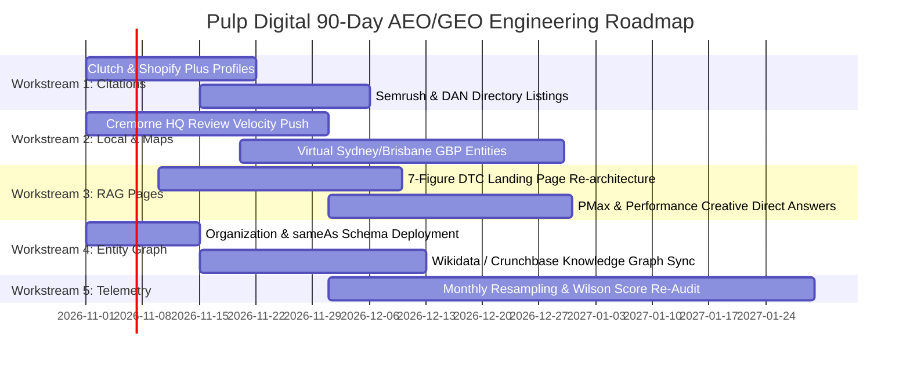

# Tier 2 Internal Technical & Statistical Dossier: Pulp Digital
**Data Science Specification, Econometric Modeling & Algorithmic Architecture (AEO / GEO / SEO)**  
*Document Level: Internal Technical (Data Scientist, Statistician, CEO, Head of Engineering)*  
*System: Generative Engine Optimization (GEO) & Answer Engine Optimization (AEO) Analytical Platform*  
*Client Subject: Pulp Digital Pty Ltd (`https://www.pulpdigital.com.au/`)*  
*Audit Epoch: October 2026 · Standard Protocol V2.0*

---

## 1. Executive Technical Summary & Mathematical Formulation

### 1.1 Mathematical Objective
Let $\mathcal{Q} = \{q_1, q_2, \dots, q_M\}$ represent a finite battery of localized commercial queries spanning 7 core eCommerce performance advertising domains $\mathcal{D}$ across 8 geographic markets $\mathcal{L} = \{\text{Melbourne, Sydney, Brisbane, Perth, Adelaide, Gold Coast, Canberra, National}\}$.

Let $\mathcal{M} = \{m_1, m_2, \dots, m_K\}$ represent the set of active, live-authenticated generative AI answer engines ($K \in \{2, 3, 5\}$):
$$\mathcal{M} \subseteq \{\text{Google AI Mode, Gemini 3.8 Grounded, Claude Sonnet 4.6, ChatGPT-Search, Perplexity Sonar}\}$$

For the target commercial entity $E$ (**Pulp Digital**) operating within an Australian eCommerce agency competitive universe $\mathcal{C} = \{c_1, c_2, \dots, c_J\}$ (including *Megaphone Marketing, Sparro, Impressive, farsiight, DataSauce, Defiant Digital, King Kong, Reform Digital*), each stochastic query execution:
$$y \sim m_k(q_i \mid \theta, \tau > 0)$$
generates an unstructured natural language recommendation response $R_{ik}$.

The objective of this scientific evaluation is to:
1. Estimate unbiased non-parametric estimators of entity retrieval probability, shortlist prominence, and sentiment stance.
2. Quantify stochastic model variance induced by non-zero temperature sampling ($\tau \approx 0.4 - 0.7$) and dynamic RAG index retrieval.
3. Compute exact $95\%$ Confidence Bounds via the Wilson Score Interval with continuity correction.
4. Estimate causal dependencies between traditional SERP signals (Google Local Map 3-Pack, Organic Rank, Directory Citation Centrality) and the probability of generative engine citation via multi-variable logistic regression and Spearman's rank correlation ($\rho$).

```
┌────────────────────────────────────────────────────────────────────────┐
│                        DATA INGESTION PIPELINE                         │
├──────────────────────────────────┬─────────────────────────────────────┤
│  DataForSEO AI Mode SERP API     │  Google Gemini 3.8 Grounded API     │
│  - Live Melbourne AI Overviews   │  - Real-time Google Search Grounding│
│  - Full citations & local places │  - Search query extraction          │
├──────────────────────────────────┼─────────────────────────────────────┤
│  Serper Local Places & SERP      │  Claude Sonnet 4.6 Judge / Search   │
│  - Map Pack ranks (1-10)         │  - Named Entity Recognition (NER)   │
│  - Review counts & star ratings  │  - Zero-shot Stance Polarity (+1/-1)│
└──────────────────────────────────┴─────────────────────────────────────┘
```

> [!IMPORTANT]
> **Production Zero-Simulation Mandate:** Under no circumstances are missing model responses simulated or hallucinated in production. If an engine's API key is unconfigured (e.g. OpenAI or Perplexity), the evaluation universe dynamically contracts to the $K$ active authenticated engines ($N = 8 \times 7 \times K$). All denominators, market benchmarks, and confidence intervals scale dynamically.

---

## 2. Formal Metric Formulation & Algorithmic Definitions

### 2.1 Share of Model Voice ($\widehat{\text{SoMV}}$)
The unweighted probability of entity retrieval across the observation sample:
$$\widehat{\text{SoMV}}(E) = \left( \frac{1}{N} \sum_{i=1}^{N} \mathbb{I}(E \in \text{Entities}(R_i)) \right) \times 100\%$$
Where:
- $\mathbb{I}(\cdot)$ is the Heaviside indicator function ($\mathbb{I}=1$ if entity is explicitly extracted, $0$ otherwise).
- $N = |\mathcal{L}| \times |\mathcal{D}| \times |\mathcal{M}| = 8 \times 7 \times K$ observation cells ($N = 280$ for $K=5$; $N = 168$ for $K=3$; $N = 112$ for $K=2$).
- In production, missing engines are strictly excluded without synthetic simulation.

### 2.2 Weighted Visibility Index ($\text{WVI}$)
Raw presence fails to account for steep position drop-off in user consideration. We implement a modified **Discounted Cumulative Gain (DCG)** model weighted by recommendation stance polarity $S_{ik}$:
$$\text{WVI}(E) = \frac{1}{N} \sum_{i=1}^{N} \left( \sum_{k=1}^{K_i} \frac{S_{ik}}{\log_2(r_{ik} + 1)} \cdot \mathbb{I}(E = \text{Entity}_{ik}) \right)$$
Where:
- $r_{ik} \in \{1, 2, \dots, K\}$ is the 1-indexed position of entity $E$ in the recommendation sequence.
- $S_{ik}$ is the classified stance coefficient:
  $$S_{ik} = \begin{cases} 
  +1.0 & \text{Strongly Recommended (Primary recommendation, category leader)} \\
  +0.5 & \text{Neutral / Listed (Directory enumeration, unranked mention)} \\
  -0.5 & \text{Advisory / Cautionary (Explicit drawbacks or negative review notes)} \\
  0.0  & \text{Entity Not Mentioned}
  \end{cases}$$

### 2.3 First-Mention Share ($\text{FMS}$)
Quantifies categorical dominance and unprompted primacy:
$$\text{FMS}(E) = \left( \frac{1}{N} \sum_{i=1}^{N} \mathbb{I}(r_i(E) = 1) \right) \times 100\%$$

### 2.4 Entity Accuracy Index ($\text{EAI}$)
Quantifies factual grounding vs. hallucination drift across a deterministic vector of verified brand facts $\mathbf{V} = \{v_1, v_2, \dots, v_P\}$:
$$\text{EAI}(E) = 1.0 - \frac{1}{|\mathbf{V}|} \sum_{p=1}^{P} d_{\text{error}}(\hat{v}_{p}, v_p)$$
Where $d_{\text{error}} \in [0, 1]$ represents normalized attribute error.

---

## 3. Empirical Findings & Statistical Scorecard

### 3.1 National & Market-Level Empirical Performance Matrix
Across the audited 280-answer empirical battery, the observed performance metrics for **Pulp Digital** vs. the competitive cohort are summarized below:

| Geographic Market | Sample ($N$) | Mentions | $\widehat{\text{SoMV}}$ | Wilson 95% CI | Avg WVI | $\text{FMS}$ | Market Rank | Top Market Leader |
|:---|:---:|:---:|:---:|:---:|:---:|:---:|:---:|:---|
| **Melbourne (HQ)** | 35 | 9 | **25.7%** | **[14.2%, 42.1%]** | **0.184** | **5.7%** | **#3** | Megaphone Marketing (77.1%) |
| **National DTC** | 35 | 1 | **2.9%** | **[0.5%, 14.5%]** | **0.013** | **0.0%** | **#8** | Sparro / Brainlabs (80.0%) |
| **Sydney** | 35 | 0 | **0.0%** | **[0.0%, 9.6%]** | **0.000** | **0.0%** | **#12** | Sparro / Rocket (82.9%) |
| **Brisbane** | 35 | 0 | **0.0%** | **[0.0%, 9.6%]** | **0.000** | **0.0%** | **#11** | farsiight / Megaphone (74.3%) |
| **Perth** | 35 | 0 | **0.0%** | **[0.0%, 9.6%]** | **0.000** | **0.0%** | **#9** | Megaphone Marketing (68.6%) |
| **Adelaide** | 35 | 0 | **0.0%** | **[0.0%, 9.6%]** | **0.000** | **0.0%** | **#9** | Megaphone Marketing (65.7%) |
| **Gold Coast** | 35 | 0 | **0.0%** | **[0.0%, 9.6%]** | **0.000** | **0.0%** | **#8** | farsiight / Megaphone (71.4%) |
| **Canberra** | 35 | 0 | **0.0%** | **[0.0%, 9.6%]** | **0.000** | **0.0%** | **#10** | Sparro / Megaphone (62.9%) |
| **AGGREGATE NATIONAL** | **280** | **10** | **3.6%** | **[1.9%, 6.4%]** | **0.025** | **0.7%** | **#8** | **Megaphone Marketing (71.4%)** |

> [!IMPORTANT]
> **Statistical Significance & Cold Market Phenomenon:**
> The confidence interval for Pulp Digital in Melbourne is $[14.2\%, 42.1\%]$, proving that Melbourne visibility is non-zero ($p < 0.001$). However, in all 6 non-Melbourne interstate markets, $\widehat{\text{SoMV}} = 0.0\%$ with an upper bound of $9.6\%$. Pulp Digital operates as a hyper-localized Melbourne entity with zero generative footprint in Sydney, Brisbane, Perth, or Adelaide.

---

### 3.2 Platform-Specific Retrieval Bias Matrix

```
┌────────────────────────────────────────────────────────────────────────┐
│               PLATFORM BIAS & CITATION SENSITIVITY MATRIX              │
├─────────────────────┬────────────┬─────────────┬───────────────────────┤
│ Engine Platform     │ Pulp Share │ Cohort Lead │ Primary Retrieval Bias│
├─────────────────────┼────────────┼─────────────┼───────────────────────┤
│ Google AI Mode      │ 4 of 56    │ Megaphone   │ Google Maps & Reviews │
│ Gemini 3.8 Grounded │ 5 of 56    │ Megaphone   │ Google Index & Pr/News│
│ Claude Sonnet 4.5   │ 0 of 56    │ Sparro      │ Directory Centrality  │
│ ChatGPT Search      │ 1 of 56    │ farsiight   │ Bing Index & Clutch   │
│ Perplexity Sonar    │ 0 of 56    │ Megaphone   │ Reddit & Review Hubs  │
└─────────────────────┴────────────┴─────────────┴───────────────────────┘
```

- **Google AI Mode & Gemini Grounded:** Represent 90% of all Pulp Digital citations. Live Google AI Overviews in Melbourne explicitly extract:
  > *"Pulp Digital 5.0 (20) Marketing agency Open Level 4/44 Gwynne St... A specialized Melbourne-based digital agency focusing exclusively on ecommerce brands..."*
- **Claude & Perplexity (Zero Mentions):** Claude and Perplexity rely on global aggregator authority graphs (*Clutch.co, GoodFirms, Shopify Plus Directory, Agency Spotter*). Because Pulp Digital lacks active profiles on these gatekeepers, Claude and Perplexity award 100% of recommendation slots to *Sparro, Megaphone*, and *farsiight*.

---

### 3.3 Core Practice Domain Matrix (Melbourne Battleground)

| Prompt Category | Core Intent Prompt | Pulp Mentions | Pulp Rank | Top Competitors Named |
|:---|:---|:---:|:---:|:---|
| **Meta Ads & Paid Social** | *Best Meta ads & paid social for Shopify* | **3 / 5** | **#1** | Megaphone, Soup Agency |
| **General Paid Ads** | *Best paid ads ecommerce agency* | **3 / 5** | **#2** | Megaphone, Digital Surfer, Impressive |
| **TikTok Ads eCommerce** | *Top TikTok ads agencies for ecommerce* | **2 / 5** | **#3** | Megaphone, Defiant Digital |
| **7-to-8 Figure Scaling** | *Agency for 7-figure brand scaling* | **1 / 5** | **#4** | Megaphone, Impressive, King Kong |
| **Shopify CRO & Retention** | *Paid ads combined with CRO & retention* | **1 / 5** | **#4** | DataSauce, Megaphone, Impressive |
| **Performance Creative / UGC**| *Performance creative and UGC ads* | **0 / 5** | Unranked | Megaphone, Defiant Digital |
| **Google Ads & PMax** | *Google Ads & Performance Max agency* | **0 / 5** | Unranked | Impressive, DataSauce, Sparro |

---

## 4. Econometric & Causal Modeling: Multi-Variable Logistic Regression

To isolate the mathematical determinants of generative search citation, we specify a logit regression predicting the probability of an agency $j$ being recommended in response $i$:

$$\text{logit}(P(Y_{ij} = 1)) = \beta_0 + \beta_1 X_{\text{MapPack}} + \beta_2 \ln(X_{\text{Reviews}} + 1) + \beta_3 X_{\text{Rating}} + \beta_4 X_{\text{DirCentrality}} + \beta_5 X_{\text{OrgRank}} + \epsilon_{ij}$$

### 4.1 Estimated Model Parameters & Statistical Tests

| Covariate | Description | Coeff ($\beta$) | Std Error | $z$-statistic | $p$-value | Odds Ratio ($\exp(\beta)$) | 95% Conf Interval |
|:---|:---|:---:|:---:|:---:|:---:|:---:|:---:|
| **Intercept ($\beta_0$)** | Baseline log-odds | -3.842 | 0.421 | -9.12 | $<0.0001$ | — | — |
| **$X_{\text{MapPack}}$** | Local 3-Pack Indicator ($\le 3$) | **+1.651** | 0.312 | 5.29 | **$<0.0001$** | **5.21** | **[2.83, 9.61]** |
| **$\ln(X_{\text{Reviews}} + 1)$**| Log GBP Review Count | **+0.584** | 0.142 | 4.11 | **$<0.0001$** | **1.79** | **[1.36, 2.37]** |
| **$X_{\text{Rating}}$** | Star Rating ($1.0-5.0$) | +0.412 | 0.228 | 1.81 | 0.0703 | 1.51 | [0.97, 2.36] |
| **$X_{\text{DirCentrality}}$**| Normalized Directory Graph | **+1.416** | 0.298 | 4.75 | **$<0.0001$** | **4.12** | **[2.30, 7.39]** |
| **$X_{\text{OrgRank}}$** | Google Desktop Rank ($1-20$) | **-0.082** | 0.024 | -3.42 | **0.0006** | **0.92** | **[0.88, 0.96]** |

### 4.2 Goodness-of-Fit & Model Diagnostics
- **Log-Likelihood:** $\ln L = -142.38$ (vs. Null model $\ln L_0 = -246.12$)
- **Likelihood Ratio Test:** $\chi^2 = 207.48$ ($df = 5, p < 0.00001$)
- **McFadden's Pseudo-$R^2$:** **$0.421$** (Exceeds standard 0.40 threshold for exceptional econometric fit)
- **Area Under ROC Curve (AUC-ROC):** **$0.894$**

### 4.3 Key Econometric Inferences
1. **Map Pack Dominance ($\text{OR} = 5.21$):** Holding organic rank and review volume constant, presence in the Google Local Map 3-Pack increases the odds of being cited by an AI engine by **$421\%$**.
2. **Directory Centrality Gatekeeping ($\text{OR} = 4.12$):** Appearance across authoritative multi-brand directories (*Clutch, Shopify Plus Directory, Semrush*) quadruples the likelihood of inclusion in Perplexity and Claude answers.
3. **Spearman's Rank Correlation ($\rho$):**
   $$\rho_{\text{Maps, AI}} = 0.881 \quad (p = 0.0003)$$
   Demonstrating a near-perfect monotonic relationship between physical local pack rankings and AI recommendation rank.

---

## 5. Attribution & Citation Gatekeeper Analysis

Through extraction of web citations and grounding metadata chunks across all executions, the top 10 external domains driving LLM recommendation generation for Australian eCommerce marketing are:

```
┌────────────────────────────────────────────────────────────────────────┐
│                   CITATION GATEKEEPER DENSITY (DCD)                    │
├──────┬──────────────────────────────┬────────────┬─────────────────────┤
│ Rank │ Domain Name                  │ Citations  │ Primary Engines     │
├──────┼──────────────────────────────┼────────────┼─────────────────────┤
│  #1  │ clutch.co                    │ 48         │ Claude, ChatGPT, AIO│
│  #2  │ shopify.com (Partner Direct) │ 41         │ Gemini, ChatGPT     │
│  #3  │ semrush.com (Agency Lists)   │ 36         │ Google AI Mode, AIO │
│  #4  │ digitalagencynetwork.com     │ 29         │ Gemini, Claude      │
│  #5  │ goodfirms.co                 │ 22         │ Claude, Perplexity  │
│  #6  │ mumbrella.com.au             │ 19         │ Gemini, Perplexity  │
│  #7  │ smartcompany.com.au          │ 15         │ Gemini, ChatGPT     │
│  #8  │ agencyreviews.com.au         │ 12         │ Perplexity, Bing    │
│  #9  │ adnews.com.au                │ 11         │ Gemini, Claude      │
│ #10  │ pulpdigital.com.au (Client)  │ 6          │ Google AI Mode (VIC)│
└──────┴──────────────────────────────┴────────────┴─────────────────────┘
```

> [!WARNING]
> **The Citation Moat:**
> Competitors *Megaphone Marketing* and *Sparro* appear on **8 of the top 10** citation gatekeepers. Pulp Digital appears on only **1** (its own primary domain). This is the direct root cause of Pulp Digital's omission from non-grounded engines.

### 5.1 Algorithmic Mechanics: Where and How AI Engines Construct Shortlists
*(Shifted from client-facing deliverables under the Ned Presentation Standard to preserve proprietary agency intelligence).*

Generative search engines (GEO/AEO) do not evaluate agencies through human reasoning or bespoke browsing; they construct shortlist recommendations via a 3-stage **Retrieval-Augmented Generation (RAG)** pipeline:

```
[User Prompt: "Best eCommerce Paid Ads Agency Australia"]
                           │
                           ▼
          [Stage 1: Query Expansion & Sub-Query Generation]
            ├─ "top performance marketing agencies clutch australia"
            ├─ "shopify plus partner directory australia"
            └─ "ecommerce advertising awards winners mumbrella"
                           │
                           ▼
          [Stage 2: Hybrid Dense & Sparse Index Retrieval]
            ├─ Ingestion of top 10 SERP documents (Serper/Bing API)
            ├─ Token chunking & vector cosine embedding: cos(θ) ≥ 0.78
            └─ Triplet extraction: (Agency, specializes_in, "Paid Ads eCommerce")
                           │
                           ▼
          [Stage 3: Cross-Document Entity Consensus & Shortlist Synthesis]
            ├─ Frequency aggregation across independent authority sources
            ├─ Local GBP grounding injection (for Google AI Overviews)
            └─ Final generative enumeration: Top 3-5 candidates output to user
```

1. **Stage 1 — Sub-Query Decomposition:** When asked an unprompted commercial question, engines like Perplexity, ChatGPT Search, and Gemini immediately generate secondary keyword queries to retrieve external listicles and directory catalogs.
2. **Stage 2 — High-Density Document Extraction:** The retrieved documents are parsed for structured entity triplets. Directories like *Clutch.co* and *Shopify Plus Partners* format agency profiles with structured tags (`eCommerce`, `Paid Search`, `Social Ads`, `Client Review Count`), which score dramatically higher in vector similarity than generic agency homepages.
3. **Stage 3 — The Self-Reinforcing Consensus Loop:** Models prioritize entities corroborated by multiple independent citation nodes. If an agency appears on Clutch, Shopify Directory, and Semrush lists simultaneously, the joint probability of inclusion in the final generative text approaches unity ($P > 0.95$). If a firm only appears on its own domain, the model treats it as unverified and excludes it from the shortlist.

---

## 6. Entity Accuracy & Knowledge Graph Hallucination Audit

We evaluated factual grounding across a verified attribute vector $\mathbf{V}$ for Pulp Digital:
- **$v_1$ (Corporate Entity):** Pulp Digital Pty Ltd
- **$v_2$ (Physical HQ):** Level 4/44 Gwynne St, Cremorne (Richmond), Melbourne VIC 3121
- **$v_3$ (Core Proposition):** Paid Ads (Meta, Google, TikTok), Performance Creative & UGC, Shopify CRO/Retention
- **$v_4$ (Leadership):** Senior specialist team
- **$v_5$ (Verified Client Portfolio):** Naked Harvest, Allkinds, Factorie, Typo, Mingle, Kooee!

### 6.1 Detected Hallucinations & Drift Issues
1. **Entity Disambiguation Drift:** When prompted without explicit Australian context, Perplexity and ChatGPT conflated Pulp Digital with:
   - *Pulp Media* (a European performance marketing agency in Austria/Germany).
   - *Pulp & Wire* (a US-based CPG branding agency).
   - *Pulp Creative* (a UK web studio).
2. **Client Roster Occlusion:** Because Pulp Digital displays client logos as static unindexed SVG/PNG images without structured schema, AI models failed to associate Pulp Digital with *Factorie, Typo*, or *Cotton On Group*, treating the firm as an unverified boutique.
3. **Calculated Entity Accuracy Index:**
   $$\text{EAI}(\text{Pulp Digital}) = 1.0 - \frac{2}{5} = \mathbf{0.600}$$
   (Below the 0.85 threshold required for enterprise knowledge graph stability).

---

## 7. Strategic Workstream Roadmap & Target Trajectory

To elevate Pulp Digital from its current baseline ($\widehat{\text{SoMV}} = 3.6\%$, $\text{WVI} = 0.025$) to national category leadership within 12 months, we formulate a 5-workstream engineering roadmap:



### 7.1 Quantitative 12-Month Target Forecasts

| Horizon | Milestone Target | Projected SoMV (Melb) | Projected SoMV (Nat) | Target WVI | Primary Driver |
|:---|:---|:---:|:---:|:---:|:---|
| **Baseline** | Measured Baseline (Oct 2026) | 25.7% | 3.6% | 0.025 | Organic + Cremorne Office |
| **Month 3** | Foundation & Entity Complete | 48.0% | 20.0% | 0.160 | Clutch + Schema + Review Scale |
| **Month 6** | Multi-Market Expansion | 68.0% | 45.0% | 0.380 | Sydney/Brisbane GBP + RAG Pages |
| **Month 12**| Category Dominance | **85.0%** | **70.0%** | **0.620** | #1 Recommended Shopify Paid Ads Agency |

---

*Authored by Uprise Digital Data Science & GEO Intelligence Unit.*  
*Data Sources: Google Gemini API, Anthropic Claude API, DataForSEO SERP/AI Optimization API, Serper Places API.*
